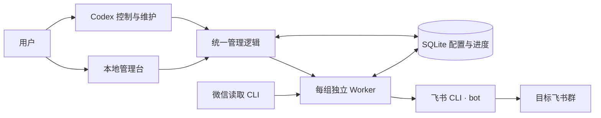

# W2F CLI

**让微信群里的对话，流动到飞书。**

W2F CLI（WeChat to Feishu）是一个由 Codex 控制与维护的本地会话镜像工具：通过微信读取 CLI 获取消息，以飞书机器人同步到指定群聊，并在管理台统一维护应用、群映射、人员实名和同步进度。

**本地运行 · 多群管理 · 实名映射 · 离线续传**

[效果展示](#效果展示) · [功能特点](#功能特点) · [快速开始](#快速开始) · [常用命令](#常用命令) · [项目文档](#项目文档)

## 效果展示

[](docs/media/w2f-cli-preview.mp4)

**[▶ 查看 / 下载带配乐的 29 秒视频](docs/media/w2f-cli-preview.mp4)** · 1080p · 30 fps

上方是无声动图预览，MP4 包含配乐。视频使用用户提供的真实微信、飞书截图，群名、姓名和头像已替换，保留原有对话与表情；管理台和恢复状态采用合成演示数据，展示进度保留、按序补齐与运行状态。画面经过 Remotion 运镜剪辑，不代表实时投递耗时；演示配置为每 10 分钟检查一次。新版采用品牌开场、消息旅程、管理台、Codex 恢复和片尾五段结构。

## 功能特点

| 功能 | 能做什么 |
| --- | --- |
| 本地管理台 | 查看运行概览，管理群映射、飞书应用、人员实名、失败项和首次接入 |
| 多应用、多群 | 同一微信账号下支持最多 10 组一对一绑定；每组指定飞书 CLI Profile，以机器人身份发送 |
| 群名称管理 | 按稳定 ID 绑定群；修改本地显示名、刷新群名，并在明确确认后修改飞书真实群名 |
| 统一实名 | 多个微信 ID 可人工关联同一人；未知身份先用昵称同步，并生成待确认事项 |
| 消息镜像 | 支持文字、emoji、链接、表情，以及读取器能获取的图片、视频和文件；正文保留发言人姓名 |
| 引用与回复 | 原消息已同步时关联飞书回复；找不到对应消息时展示可读引用或占位 |
| 离线续传 | 保存游标与发送回执；服务恢复后按源消息顺序补齐积压，再继续处理新消息 |
| 独立运行 | 每组绑定独立 Worker、锁、游标与心跳；可单独启停、暂停和恢复 |
| 失败可追踪 | 媒体获取或上传失败时保留占位和待办，支持人工排查后补发 |
| Codex 管理 | 网页与 CLI 共用 SQLite 和管理逻辑；Codex 执行启动、停止、状态查询与排障 |

实名更正对后续消息生效，历史消息保留发送时的姓名。未知身份的飞书私聊提醒需要先配置并核实管理员身份。

## 工作方式



首次启动一条新绑定时，从当前最新消息开始。后续启动、恢复或重连使用保存的进度，先完整读取离线区间，再按源时间与消息序号依次发送。姓名和群配置由数据库统一提供。

Codex 负责服务控制和维护，Worker 负责持续读取与发送。按产品 Spec 的最小守护集：`python3 -m agents.manage watchdog` 自动拉起异常退出的 Worker（连续重启失败会停机并留痕，等待人工排查）；Windows 上可注册登录计划任务，开机后自动恢复管理台、watchdog 与运行中的绑定（见下文「开机自启」），不引入系统服务或其他更重的进程管家。

## 快速开始

### 1. 准备环境

支持 macOS 与 Windows 两类接入，微信侧依赖不同、其余完全同一套代码：

| 能力 | macOS | Windows |
| --- | --- | --- |
| 微信读取器 | `rion-wechat-cli` | [WeChatDataAnalysis](https://github.com/LifeArchiveProject/WeChatDataAnalysis) + 内置适配层 |
| 近实时唤醒 | 常规轮询 | 可选 `realtime_wakeup`（SSE 事件） |
| 媒体管线 | 读取器本地路径 | WDA 解密接口 + 本地暂存缓存 |
| Worker / 管理台 / CLI / 飞书发送 | ✅ 同一套 | ✅ 同一套 |

两个平台共同需要：

- Python 3.10+。
- 已安装并登录微信。
- `lark-cli`，以及具备目标群访问、消息发送和所需媒体权限的飞书机器人应用（Worker 优先用 PATH 中的 `lark-cli`，找不到时自动检查 `~/.local/bin/lark-cli`）。
- `ffmpeg`（可选）：用于生成视频封面；缺少时使用文件附件。

Node.js 只用于网页脚本检查和可选的 Remotion 宣传片制作，不是同步服务的运行依赖。

在项目根目录安装依赖：

```bash
python3 -m venv .venv
source .venv/bin/activate          # Windows: .venv\Scripts\activate
python3 -m pip install -r requirements.txt
```

### 2. 接入微信读取器

**macOS**：按微信读取 CLI 的首次接入流程授权，并确认 `reader.sh access-plan` 可读。然后为已安装读取器增加完整分页扩展，将下列路径替换为实际的引擎文件：

```bash
python3 scripts/install_reader_sync.py /实际路径/rion_wechat_reader.py
```

脚本保留引擎备份，只添加 `sync-page`，不修改微信数据库。重新安装读取器后需要重新应用扩展；可通过 `WECHAT_READER` 指定兼容的 CLI 入口。

**Windows**：安装并登录桌面版微信（4.x），保持 [WeChatDataAnalysis](https://github.com/LifeArchiveProject/WeChatDataAnalysis) 运行（本地 API 默认 `http://localhost:10392`，首次使用需在其界面内完成密钥提取与数据库解密）。然后生成适配层垫片并在运行配置中登记：

```powershell
.venv\Scripts\python scripts\install_wda_reader.py
```

```json
"wechat_reader": "C:\\...\\integrations\\wda_reader.cmd",
"realtime_wakeup": true
```

两个平台的读取器都必须实现[读取器契约](docs/读取器契约.md)（`sync-page` / `resolve-chat` / `media`，`ordered_sync_v1` 有序分页）。

### 3. 打开管理台，完成引导

```bash
python3 -m agents.manage serve
```

打开命令返回的本机授权链接，在“接入引导”中完成以下步骤：

1. 发现已有飞书 Profile，或接入已有应用凭证。
2. 搜索并选择微信群和飞书群，指定发送应用。
3. 填写管理员信息，核实提醒使用的应用及管理员身份。
4. 检查接入并初始化，将绑定保存为待启动。

凭证交给飞书 CLI 保存，项目只登记 App ID 和 Profile 引用。打开网页、保存草稿和初始化都不会自动开始镜像。

### 4. 启动指定绑定

在网页的“群映射”中启动，或告诉 Codex 启动指定群。也可以使用 CLI，先查询绑定 ID：

```bash
python3 -m agents.manage bindings list
python3 -m agents.manage bindings start --id 1
python3 -m agents.manage status
```

示例中的 `1` 应替换为实际绑定 ID。默认每 600 秒检查一次，可在接入配置中设置间隔。

## 常用命令

以下命令供用户或 Codex 调用，返回 JSON，并与网页共享同一份状态。

| 操作 | 命令 |
| --- | --- |
| 查询整体状态 | `python3 -m agents.manage status` |
| 查看飞书应用 | `python3 -m agents.manage profiles list` |
| 查看群映射 | `python3 -m agents.manage bindings list` |
| 查看人员档案 | `python3 -m agents.manage people list` |
| 查看待确认事项 | `python3 -m agents.manage confirmations list` |
| 启动 / 异常退出后重启 | `python3 -m agents.manage bindings start --id 1` |
| 守护运行（自动拉起异常退出的 Worker） | `python3 -m agents.manage watchdog` |
| 注册 / 注销开机自启（Windows） | `python3 -m agents.manage autostart --register` / `--unregister` |
| 验收指标（时延分位数 / 媒体成功率 / 连续性） | `python3 -m agents.manage metrics --days 7` |
| 暂停 | `python3 -m agents.manage bindings pause --id 1` |
| 恢复暂停中的 Worker | `python3 -m agents.manage bindings resume --id 1` |
| 停止 | `python3 -m agents.manage bindings stop --id 1` |

暂停和停止都保留进度。`resume` 只恢复仍在运行的暂停 Worker；停止或进程异常退出后使用 `start`。

### 开机自启（Windows）

在管理台「运行概览」一键启用，或使用 CLI 注册：

```bash
python3 -m agents.manage autostart --register
```

注册的是当前用户的登录计划任务：登录后自动运行一次开机恢复——拉起管理台和 watchdog，并把重启前处于运行状态的绑定全部拉起。已停止、暂停或归档的绑定不会被拉起；重复运行是安全的（管理台按活动会话跳过，watchdog 有单例锁，绑定启动本身幂等）。`--unregister` 注销后重启不再自启。注册动作会保存当前解释器与配置路径，移动仓库或换 Python 后需重新注册。

## 配置与数据

代码与运行数据分开存放，项目里的配置文件为空白示例。

| 内容 | 默认位置 |
| --- | --- |
| 本机配置 | `~/.config/w2f-cli/wechat_feishu_mirror.json` |
| SQLite、日志、媒体、备份、管理会话 | `~/.local/share/w2f-cli/` |
| 可复制的配置示例 | [`config/wechat_feishu_mirror.json`](config/wechat_feishu_mirror.json) |
| README 展示素材 | [`docs/media/`](docs/media/README.md) |

通过 `W2F_CONFIG_DIR`、`W2F_DATA_DIR` 可切换到隔离的配置和数据目录；旧版 `CHZ_CONFIG_DIR`、`CHZ_DATA_DIR` 仍作为兼容 fallback。`W2F_MEDIA_DIR` 可指定媒体暂存目录，`WECHAT_READER` 用于覆盖微信 CLI 入口。

管理员私聊提醒需要在其所属 `admin_profile` 下核实 `admin_feishu_user_id`，不能复制另一应用的 `open_id`。当前已有绑定的管理员配置由 Codex 修改本地配置；网页“保存进度”只保存引导草稿。

## 当前边界

- **时效性**：默认定时检查为 10 分钟，不保证秒级同步；Windows 端可开启 `realtime_wakeup` 事件唤醒。
- **媒体可用性**：新格式加密图片、转发记录内独立媒体和超过 100 MB 的文件仍需后续适配；源端缺失的资源会保留占位。图片优先同步原图（Windows 端经 WDA 拉取 CDN 原图；原图过期时回落缩略图，并在飞书消息上标注「原图未同步」）。
- **视频号**：卡片与链接已做解析处理，跨应用跳转仍待完善，不能保证在飞书中直接播放或打开。
- **恢复条件**：续传依赖微信历史仍可读取；已删除的历史或缺失的原文件无法凭空重建。
- **不确定回执**：发送结果不确定且超过平台去重窗口时暂停等待核对，避免盲目重复发送。
- **Windows 读取器依赖**：Windows 端读取依赖第三方项目 WeChatDataAnalysis（本项目不维护其解密能力；微信大版本更新可能需要其跟进适配，密钥提取需要微信保持登录）。适配层以 WDA v2.6.0 实测为准；WDA 不可用时自动回落为断线重连，游标不丢。

## 开发与验证

```bash
python3 -m unittest discover -s tests -v
node --check agents/web/app.js
python3 scripts/check_public_tree.py
git diff --check
```

自动测试在临时目录使用模拟读取器和飞书 CLI，涵盖真实 Worker 子进程、10 组并行、5,500 条源记录、断线重启、分段回执、媒体占位和迁移回滚，不向真实群发送消息。真实验收范围见下方报告。

提交问题时，请附上复现步骤、预期行为和脱敏后的错误信息。修改同步行为时，应补充对应的消息格式、重试或恢复测试。

## 项目文档

- [开发计划与迭代需求](docs/微信到飞书群镜像同步计划.md)
- [同步验收表](docs/微信飞书镜像同步验收表.md)
- [v0.3 恢复专项验收报告](docs/版本说明-v0.3-恢复专项验收.md)
- [v0.2 多应用、多群与人员管理](docs/版本说明-v0.2.md)
- [Agent 运行规范](docs/微信飞书镜像%20Agent%20运行规范.md)
- [宣传片 Remotion 工程](promo/README.md)
- [新机器部署前置准备](docs/新机器部署前置准备.md)
- [读取器契约](docs/读取器契约.md)

当前文件检查不覆盖 Git 历史。旧历史中仍有早期个人接入记录和配置，公开推送前需清理历史或从脱敏工作树新建公开仓库；项目不会自动推送或重写历史。
