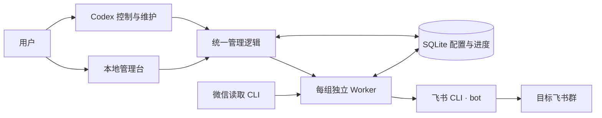

# W2F CLI

当前版本：**v0.3.2**。本次更新包含读取降频、媒体恢复与原始文件名保留。

**让微信群里的对话，流动到飞书。**

W2F CLI（WeChat to Feishu）是一个由 Codex 控制与维护的本地会话镜像工具：通过微信读取 CLI 获取消息，以飞书机器人同步到指定群聊，并在管理台统一维护应用、群映射、人员实名和同步进度。

**本地运行 · 多群管理 · 实名映射 · 离线续传**

[效果展示](#效果展示) · [功能特点](#功能特点) · [快速开始](#快速开始) · [飞书权限申请](#飞书权限申请) · [常用命令](#常用命令) · [项目文档](#项目文档)

## 效果展示

[](docs/media/w2f-cli-preview.mp4)

**[▶ 查看 / 下载带配乐的 29 秒视频](docs/media/w2f-cli-preview.mp4)** · 1080p · 30 fps

上方是无声动图预览，MP4 包含配乐。视频使用用户提供的真实微信、飞书截图，群名、姓名和头像已替换，保留原有对话与表情；管理台和恢复状态采用合成演示数据，展示进度保留、按序补齐与运行状态。画面经过 Remotion 运镜剪辑，不代表实时投递耗时；演示配置为每 10 分钟检查一次。新版采用品牌开场、消息旅程、管理台、Codex 恢复和片尾五段结构。

## 功能特点

| 功能 | 能做什么 |
| --- | --- |
| 本地管理台 | 查看运行概览，管理群映射、飞书应用、人员实名、失败项和首次接入 |
| 多应用、多群 | 同一微信账号下支持最多 10 组一对一绑定；每组指定飞书 CLI Profile，以机器人身份发送 |
| 向导内建群 | 一键填入当前微信群名，继续编辑后创建；搜索并勾选当前应用下最多 50 名初始成员，创建后核验成员结果 |
| 群名称管理 | 按稳定 ID 绑定群；修改本地显示名、刷新群名，并在明确确认后修改飞书真实群名；可逐群开启群名自动跟随（默认关闭） |
| 群成员同步 | 逐群确认开启，默认关闭；可信微信事件结合已确认双端身份，执行飞书成员变更；不确定情况保留待办 |
| 统一实名 | 多个微信 ID 可人工关联同一人；关联飞书身份时可按实名、相近姓名和拼音查通讯录，核对候选 ID 后选择；未知身份先用昵称同步，并生成待确认事项 |
| 消息镜像 | 支持文字、emoji、链接、表情，以及读取器能获取的图片、视频和文件；正文保留发言人姓名 |
| 引用与回复 | 原消息已同步时关联飞书回复；找不到对应消息时展示可读引用或占位 |
| 离线续传 | 保存游标与发送回执；服务恢复后按源消息顺序补齐积压，再继续处理新消息 |
| 独立运行 | 每组绑定独立 Worker、锁、游标与心跳；可单独启停、暂停和恢复 |
| 失败可追踪 | 媒体获取或上传失败时保留占位和待办，支持人工排查后补发 |
| Codex 管理 | 网页与 CLI 共用 SQLite 和管理逻辑；Codex 执行启动、停止、状态查询与排障 |

人员可解除单项身份关联、归档和恢复；有关联或使用历史的人员不能直接删除。实名更正对后续消息生效，历史消息保留发送时的姓名。未知身份的飞书私聊提醒需要先配置并核实管理员身份。通讯录姓名搜索需要所选 Profile 的用户授权与可见范围；搜索失败时可继续手工填写该应用下的 `open_id`。

## 工作方式



首次启动一条新绑定时，从当前最新消息开始。后续启动、恢复或重连使用保存的进度，先完整读取离线区间，再按源时间与消息序号依次发送。姓名和群配置由数据库统一提供。

Codex 负责服务控制和维护，Worker 负责持续读取与发送。按产品 Spec 的最小守护集：`python3 -m agents.manage watchdog` 自动拉起异常退出的 Worker（连续重启失败会停机并留痕，等待人工排查）；Windows 上可注册登录计划任务，开机后自动恢复管理台、watchdog 与运行中的绑定（见下文「开机自启」），不引入系统服务或其他更重的进程管家。

## 快速开始

### 1. 准备环境

支持 macOS 与 Windows 两类接入，微信侧依赖不同、其余完全同一套代码：

| 能力 | macOS | Windows |
| --- | --- | --- |
| 微信读取器 | `rion-wechat-cli` | [WeChatDataAnalysis](https://github.com/LifeArchiveProject/WeChatDataAnalysis) + 内置适配层 |
| 近实时唤醒 | 常规轮询 | 可选 `realtime_wakeup`（SSE 事件） |
| 媒体管线 | 读取器本地路径 | WDA 解密接口 + 本地暂存缓存 |
| Worker / 管理台 / CLI / 飞书发送 | ✅ 同一套 | ✅ 同一套 |

Windows 端的机器级前置工作（WDA 与桌面微信的启动要求、开机自启的注册与重启验收）集中在 [`docs/Windows前置工作.md`](docs/Windows前置工作.md)。

两个平台共同需要：

- Python 3.10+。
- 已安装并登录微信。
- `lark-cli`，以及具备目标群访问、消息发送和所需媒体权限的飞书机器人应用（[权限清单、申请命令与模型提示词](#飞书权限申请)；Worker 优先用 PATH 中的 `lark-cli`，找不到时自动检查 `~/.local/bin/lark-cli`）。
- `ffmpeg`（可选）：用于生成视频封面；缺少时使用文件附件。

Node.js 只用于网页脚本检查和可选的 Remotion 宣传片制作，不是同步服务的运行依赖。

在项目根目录安装依赖：

```bash
python3 -m venv .venv
source .venv/bin/activate          # Windows: .venv\Scripts\activate
python3 -m pip install -r requirements.txt
```

需要本机 SILK 语音转码时，另安装 FFmpeg 和可选依赖：

```bash
python3 -m pip install -r requirements-voice.txt
```

### 2. 接入微信读取器

**macOS**：按微信读取 CLI 的首次接入流程授权，并确认 `reader.sh access-plan` 可读。然后为已安装读取器增加完整分页扩展，将下列路径替换为实际的引擎文件：

```bash
python3 scripts/install_reader_sync.py /实际路径/rion_wechat_reader.py
```

脚本保留版本备份，原子安装 `sync-page`、`watch-changes` 与 `voice-resource` 扩展，失败回滚；不修改微信数据库。重新安装读取器后需要重新应用扩展；可通过 `WECHAT_READER` 指定兼容的 CLI 入口。

**Windows**：安装并登录桌面版微信（4.x），保持 [WeChatDataAnalysis](https://github.com/LifeArchiveProject/WeChatDataAnalysis) 运行（本地 API 默认 `http://localhost:10392`，首次使用需在其界面内完成密钥提取与数据库解密）。然后生成适配层垫片并在运行配置中登记：

```powershell
.venv\Scripts\python scripts\install_wda_reader.py
```

```json
"wechat_reader": "C:\\...\\integrations\\wda_reader.cmd",
"realtime_wakeup": true
```

两个平台的读取器都必须实现[读取器契约](docs/读取器契约.md)（`sync-page` / `resolve-chat` / `media`，`ordered_sync_v1` 有序分页）。

### 3. 打开管理台，完成引导

```bash
python3 -m agents.manage serve
```

打开命令返回的本机授权链接，在“接入引导”中完成以下步骤：

1. 发现已有飞书 Profile，或接入已有应用凭证。
2. 搜索并选择微信群和飞书群，指定发送应用。
3. 填写管理员信息，核实提醒使用的应用及管理员身份。
4. 检查接入并初始化，将绑定保存为待启动。

凭证交给飞书 CLI 保存，项目只登记 App ID 和 Profile 引用。打开网页、保存草稿和初始化都不会自动开始镜像。

### 4. 启动指定绑定

在网页的“群映射”中启动，或告诉 Codex 启动指定群。也可以使用 CLI，先查询绑定 ID：

```bash
python3 -m agents.manage bindings list
python3 -m agents.manage bindings start --id 1
python3 -m agents.manage status
```

示例中的 `1` 应替换为实际绑定 ID。默认每 600 秒检查一次，可在接入配置中设置间隔。

## 飞书权限申请

以下以独立 Profile `wechat-mirror` 为例，命令按 **Lark CLI v1.0.95** 核对。换应用时替换 Profile 名称，并核对它对应的 App ID；保留原有通用应用 `feishu-mcp`。先在飞书开放平台启用机器人能力，将应用凭证接入该 Profile，凭证由 CLI 保存。

**权限分两层：机器人应用权限在开放平台开通；用户授权通过 `lark-cli auth login` 完成。** 自动镜像、群管理、管理员提醒都用 `--as bot`；后台按实名搜索飞书人员用 `--as user`。用户扫码成功不能证明机器人权限已齐全。[CLI 官方权限说明](https://github.com/larksuite/cli/blob/main/skills/lark-shared/references/lark-shared-identity-and-permissions.md)

### 需要哪些权限

在开放平台“权限管理”中按对应身份搜索权限标识，按所需功能开通：

| 功能 | 身份 | 权限标识 | 使用条件 |
| --- | --- | --- | --- |
| 同步文字、链接、引用回复；发送管理员私聊提醒 | bot | `im:message:send_as_bot` | 基础必需 |
| 上传图片、表情、视频、语音、文件 | bot | `im:resource` | 媒体镜像必需；部分 API 也接受细分上传权限，以实际 CLI 错误为准 |
| 列出/搜索目标群、读取群名、获取邀请链接 | bot | `im:chat:read` | 管理台接入必需 |
| 检查机器人在群、读取成员、核验成员同步结果 | bot | `im:chat.members:read` | 创建绑定预检必需 |
| 从管理台创建飞书群 | bot | `im:chat:create` | 使用创建群功能时 |
| 修改飞书真实群名、开启群名跟随 | bot | `im:chat:update` | 仅修改本地显示名不需要 |
| 邀请本人入群、同步成员加入/移除 | bot | `im:chat.members:write_only` | 使用邀请或成员同步时 |
| 按消息 ID 读取飞书群消息，核对不确定发送回执 | bot | `im:message.group_msg` | 使用回执核验时；本项目加 `--no-reactions`，不为此申请表情回复读取权限 |
| 按实名、相近姓名、拼音搜索飞书候选人 | user | `contact:user:search` | 使用人员搜索时；手工关联已核实的 `open_id` 可不启用 |

创建者机器人需要以群主身份操作时，按实际群设置补充 `im:chat:operate_as_owner`；它不能让机器人管理任意群。权限之外还要满足：机器人在目标群内、邀请对象和提醒接收人在应用可用范围内、修改群信息/移除成员符合该群角色要求。成员同步仍须在项目内逐组确认开启，取得权限不会自动打开开关。

上述清单对应项目实际调用的 [消息发送](https://github.com/larksuite/cli/blob/v1.0.95/shortcuts/im/im_messages_send.go)、[消息核验](https://github.com/larksuite/cli/blob/v1.0.95/shortcuts/im/im_messages_mget.go)、[人员搜索](https://github.com/larksuite/cli/blob/v1.0.95/shortcuts/contact/contact_search_user.go) 等接口；不需要为了单向镜像申请日历、云盘或全部业务域权限。

### 写法一：直接使用 Lark CLI

**1. 检查 Profile 和授权状态。** 以下示例在已安装 CLI 的终端执行；macOS 若提示找不到命令，先执行 `export PATH="$HOME/.local/bin:$PATH"`。

```bash
lark-cli --version
lark-cli profile list
lark-cli --profile wechat-mirror auth status --json --verify
lark-cli --profile wechat-mirror auth scopes --json
```

`auth scopes` 在上述版本返回 `userScopes`，用于检查应用支持的用户权限，不能据此断言 bot 权限齐全。`auth status` 中用户令牌过期，也不等于机器人不可用。

**2. 开通机器人权限。** 当前 CLI 没有一条 `auth login` 命令能开通上述 bot 权限。前往 `https://open.feishu.cn/app/<你的 App ID>/auth`，在“应用身份权限”中按表申请缺项，按后台要求创建版本、发布并完成组织审批。CLI 报错若给出 `console_url`，优先使用该入口；`permission_violations` 中可能是“任选其一”，不必把等价权限全部开通。

**3. 需要人员搜索时，申请用户授权。** 先在同一应用的“用户身份权限”中开通 `contact:user:search` 并完成发布/审批，再执行：

```bash
lark-cli --profile wechat-mirror auth login --scope "contact:user:search"
```

打开本次命令返回的链接，使用自己的飞书账号完成授权。此命令等待授权完成；不要省略 `--scope`，也不用 `--domain all`。

如果由 Codex 等模型代办，使用下面的分步方式，先取得授权链接，方便模型交还对话让你扫码：

```bash
lark-cli --profile wechat-mirror auth login \
  --scope "contact:user:search" --no-wait --json
```

模型应展示本次返回的原始授权链接及二维码。你完成授权并回复后，再由模型执行下一条命令；占位符替换为**同一次请求**返回的 `device_code`，过期则重新发起：

```bash
lark-cli --profile wechat-mirror auth login \
  --device-code "<本次返回的 device_code>"
```

授权链接、二维码及 `device_code` 不放进仓库。授权后检查实际取得的权限，再做只读验证：

```bash
lark-cli --profile wechat-mirror auth check --scope "contact:user:search" --json
lark-cli --profile wechat-mirror auth status --json --verify
lark-cli --profile wechat-mirror contact +search-user --user-ids me --as user
lark-cli --profile wechat-mirror im +chat-list --page-size 1 --as bot
```

从管理台或群列表取得真实 `chat_id`，再核对目标群成员：

```bash
lark-cli --profile wechat-mirror im +chat-members-list \
  --chat-id "<目标群 chat_id>" --member-types bot --page-all --as bot
```

这些是只读检查，不能证明消息发送、媒体上传、成员增删已经验收；写操作需在你指定的测试群内另行验证。若返回“需要管理员审批”，用户扫码不能代替组织审批；保留具体缺项和审批入口，可先使用已获批功能，或接入另一个获准使用的应用。

### 写法二：交给 Codex 或其他模型的提示词

复制下面整段即可使用；如需换 Profile，请修改第一行：

```text
请帮我配置 W2F CLI 的飞书权限，使用独立 Profile：wechat-mirror。

先阅读本项目 README 的“飞书权限申请”，检查已安装 lark-cli 的版本、
命令帮助、Profile 对应的 App ID、应用已开通权限和用户实际授权状态。
不要改动通用应用 feishu-mcp，也不要把其他应用的 open_id 拿来复用。

按 README 权限表检查消息/媒体同步、群读取和成员预检的基础权限；
同时准备创建群、修改群名、邀请和移除成员、群消息回执核验，以及
按姓名搜索人员所需的权限。区分 bot 与 user，只申请对应功能的缺项，
不要使用 --domain all，不要把 auth scopes 的 userScopes 当作 bot 权限。

用户授权用当前 CLI 支持的精确 scope 发起；人员搜索需要
contact:user:search。代理执行时运行：
lark-cli --profile wechat-mirror auth login --scope "contact:user:search" --no-wait --json
把本轮返回的原始授权链接及用 auth qrcode 生成的二维码展示给我，
告诉我需要扫码，并先交还对话。等我回复已授权，再用本轮 device_code
运行 lark-cli --profile wechat-mirror auth login --device-code "<本次 device_code>"
完成授权流程；过期就重新发起。授权材料保存在仓库外，不写进 Git。

bot 缺权限时，不用 auth login 冒充机器人授权：列出具体缺项及
console_url，协助在开放平台开通、发布。需要组织审批时告诉我
由谁审批、审批入口和目前受影响的功能，不把扫码成功当作审批完成。
不要在聊天、日志或仓库里输出 App Secret 或访问令牌。

完成后用 auth check、auth status 和只读 API 分别核验用户身份、
机器人可用性、目标群成员及应用可用范围，给出“已通过/待审批/待实测”
清单。只读检查通过后不要直接声称发送或成员增删验收成功；需要写入
测试时先让我指定测试群与操作内容，不向工作群试发消息或移除成员。
```

## 常用命令

以下命令供用户或 Codex 调用，返回 JSON，并与网页共享同一份状态。

| 操作 | 命令 |
| --- | --- |
| 查询整体状态 | `python3 -m agents.manage status` |
| 查看飞书应用 | `python3 -m agents.manage profiles list` |
| 查看群映射 | `python3 -m agents.manage bindings list` |
| 查看人员档案 | `python3 -m agents.manage people list` |
| 从已绑定微信群查成员候选 | `python3 -m agents.manage people search-wechat --binding-id 1 --query 小明` |
| 从本机联系人查候选 | `python3 -m agents.manage people search-wechat --source-account default --query 王小明` |
| 按实名查飞书候选人 | `python3 -m agents.manage people search-feishu --profile-name wechat-mirror --name 王小明` |
| 查看待确认事项 | `python3 -m agents.manage confirmations list` |
| 启动 / 异常退出后重启 | `python3 -m agents.manage bindings start --id 1` |
| 守护运行（自动拉起异常退出的 Worker） | `python3 -m agents.manage watchdog` |
| 注册 / 注销开机自启（Windows） | `python3 -m agents.manage autostart --register` / `--unregister` |
| 验收指标（时延分位数 / 媒体成功率 / 连续性） | `python3 -m agents.manage metrics --days 7` |
| 暂停 | `python3 -m agents.manage bindings pause --id 1` |
| 恢复暂停中的 Worker | `python3 -m agents.manage bindings resume --id 1` |
| 停止 | `python3 -m agents.manage bindings stop --id 1` |

暂停和停止都保留进度。`resume` 只恢复仍在运行的暂停 Worker；停止或进程异常退出后使用 `start`。

### 开机自启（Windows）

在管理台「运行概览」一键启用，或使用 CLI 注册：

```bash
python3 -m agents.manage autostart --register
```

注册的是当前用户的登录计划任务：登录后自动运行一次开机恢复——拉起管理台和 watchdog，并把重启前处于运行状态的绑定全部拉起。已停止、暂停或归档的绑定不会被拉起；重复运行是安全的（管理台按活动会话跳过，watchdog 有单例锁，绑定启动本身幂等）。`--unregister` 注销后重启不再自启。注册动作会保存当前解释器与配置路径，移动仓库或换 Python 后需重新注册。

WDA 与桌面微信不在此自启范围内，属每次开机后的手动项——详见 [`docs/Windows前置工作.md`](docs/Windows前置工作.md)（含重启验收流程）。

在管理台「人员与实名」中，优先从待确认发言人选用稳定微信 ID；需要提前关联时可按微信群成员或本机联系人搜索。昵称、备注与拼音仅用于查候选，选择后仍须人工核对真人。普通关联不会覆盖其他人员的 ID；核实后可在人员详情中用「更正归属」并填写原因。更正只影响后续镜像，历史消息姓名保留原样。缺少稳定 ID 的消息不能按昵称关联。

## 配置与数据

代码与运行数据分开存放，项目里的配置文件为空白示例。

| 内容 | 默认位置 |
| --- | --- |
| 本机配置 | `~/.config/w2f-cli/wechat_feishu_mirror.json` |
| SQLite、日志、媒体、备份、管理会话 | `~/.local/share/w2f-cli/` |
| 可复制的配置示例 | [`config/wechat_feishu_mirror.json`](config/wechat_feishu_mirror.json) |
| README 展示素材 | [`docs/media/`](docs/media/README.md) |

通过 `W2F_CONFIG_DIR`、`W2F_DATA_DIR` 可切换到隔离的配置和数据目录；旧版 `CHZ_CONFIG_DIR`、`CHZ_DATA_DIR` 仍作为兼容 fallback。`W2F_MEDIA_DIR` 可指定媒体暂存目录，`WECHAT_READER` 用于覆盖微信 CLI 入口。

管理员私聊提醒需要在其所属 `admin_profile` 下核实 `admin_feishu_user_id`，不能复制另一应用的 `open_id`。在“人员与实名”页选择本人和发送 Profile 后，可点“读取此应用保存的用户 ID”从该 Profile 的 CLI 授权记录填入 ID；若授权已过期，页面会注明是上次保存的身份，仍须核对姓名后保存。读取不到时，页面提供 CLI 查询和联系应用管理员的指引。已有绑定可在管理台“接入引导”保存管理员身份与运行参数；新管理员必须先在“人员与实名”页关联到提醒应用。实时唤醒和轮询间隔变更在 Worker 重启后生效。

## 当前边界

- **时效性**：默认定时兜底为 10 分钟；macOS 端可在引导页开启 Rion `reader_wakeup` 只读事件唤醒，Windows 端可开启 `realtime_wakeup`。秒级端到端时延仍须按真实群消息实测。
- **媒体可用性**：图片已支持旧 XOR、V1/V2；未知加密格式、缺少本机解码条件、转发记录内独立媒体和超过 100 MB 的文件仍需另行处理；源端缺失的资源会保留占位。图片优先同步原图（Windows 端经 WDA 拉取 CDN 原图；原图过期时回落缩略图，并在飞书消息上标注「原图未同步」）。
- **长合并转发**：按内层记录顺序分段，标题和续段提示计入每条 12,000 UTF-8 字节的应用预算；外层转发人只在首段显示。单条超长正文标注“续上一条”，可容纳的链接保持完整，重试沿用已保存的分段和姓名。单个链接本身超过可用预算时，该条保留失败状态供人工处理；真实百条记录和转发内媒体仍需分别验收。
- **合并转发内的视频（macOS）**：通过 `forward-resource` 读取器扩展，按外层消息与子项位置找到本机已下载的完整 MP4，并核对大小和内容摘要。视频作为回复关联到包含该子项的正文段，附带原发言人和记录序号；有 FFmpeg 时上传视频及封面，否则上传视频文件。每个视频独立保存回执，失败进入管理台媒体失败项，可单独重试，正文不会整份重发。当前仅支持本机完整文件且不超过 100 MB；未下载或资源缺失时保留占位，下载后可重试。
- **普通图片自动补原图**：默认额外等待最多 5 秒，优先发送原图；只有缩略图时先同步，再于 30 秒后检查，后续分别间隔 2 分钟、10 分钟检查，总共最多三次。找到原图就回复到原图片，不重复姓名或缩略图。次数耗尽后转人工待办；暂停、停止和重启保留进度，旧待办不会自动补发。管理台「失败与补发」显示次数和下次检查时间。参见[排查证据与恢复步骤](docs/图片与表情资源修复.md)。
- **普通文件与 PDF**：识别发送中和已完成的文件消息，正确读取 CDATA 文件名；按源消息、大小和摘要核验附件，上传时保留原文件名。发送中的文件尚未就绪时先占位并有限重试，超过上限转人工。已误发为纯标题的旧记录可明确补附件到原消息下。参见[文件完成状态与恢复步骤](docs/普通文件消息修复.md)。
- **读取降频**：轻量监听保持每秒检查；每组完整扫描默认至少间隔 10 秒，合并期间的重复通知，按游标补齐全部新消息。保留 600 秒兜底，图片与文件补发单独调度。详见[消息读取降频](docs/消息读取降频.md)。
- **合并转发内的图片（macOS）**：同一读取器按消息与子项身份查找图片，包括转发记录中的 V2 加密缓存；沿用已授权的本机图片解码能力，核对解码后的大小和内容摘要，优先上传完整图片，仅找到可靠缩略图时明确标注。多张图片及图片/视频混排独立保存回执并按记录次序回复；未知发送结果冻结图片内容与清晰度，无法重建原发送图片时等待核对。明确上传失败后可重新选择已下载的原图，质量变化会补充说明。缺资源或解码失败保留后台待办，重试不重发正文或成功媒体。

旧版已经只发出“[视频]”或“[图片]”的记录，可先由 Codex 核对本地消息编号和目标群，再明确补齐这一条。编号为项目数据库的 `messages.id`，不是微信的 `local_id`：

```bash
python3 -m agents.manage media-failures forward-videos --id <本地消息编号>
python3 -m agents.manage media-failures forward-images --id <本地消息编号>
```

选择需要补齐的媒体类型运行命令，只为指定记录排队，保留原正文及成功回执；历史正文或姓名已变化、回执不完整时停止并提示核对。已上传的媒体不会重复发送。升级读取器前先停止 Worker，再运行上面的读取器扩展安装命令并恢复原绑定。
- **语音回退**：macOS 读取器可从已授权的语音库按群与消息身份提取 SILK；安装可选 pilk 和 FFmpeg 后转为 Opus。macOS 后台优先使用 PATH 中的 FFmpeg，缺失时检查 Homebrew 常见安装目录，视频封面共用此规则。已有 Opus 文件按语音发送；AMR/AAC/M4A/MP3/WAV 在安装 FFmpeg 后转为 Opus。无法转码的原始文件作为附件发送，客户端内播放能力需按格式验收。
- **文章分享**：type-5 微信分享保留标题、摘要和完整原文链接，用户要求的是微信链接的原生标题/封面预览，不使用 interactive 卡片替代；原生预览由飞书决定。不再额外发送封面图片或图片链接，避免 CLI 上传降级产生多余回复；源封面元数据仍保留。旧版封面失败和不确定回执保留待核对，重试不会再补发封面。纯粘贴链接不主动抓网页，原生预览效果受原文可访问性及飞书解析影响；同文长短链接的标题、封面及原文打开已于 2026-09-29 经用户现场确认通过（#23）。
- **视频号**：优先保留原分享页，正确解析 CDATA 与 XML 实体；只有内部 ID 时，按 uint64 大端序与无填充 Base64URL 转换页面参数，异常字段或资源地址回退为占位。编码规则已有自动测试，修正候选链接可在微信打开、本机部署后获用户最终认可，#26 已关闭；验收未提供逐客户端结果表，不保证所有视频可打开或在飞书中播放。已有投递计划和历史消息不会自动改写或重发；T66 的缺链接追踪待办仍未完成。
- **恢复条件**：续传依赖微信历史仍可读取；已删除的历史或缺失的原文件无法凭空重建。
- **不确定回执**：发送结果不确定且超过平台去重窗口时暂停等待核对，避免盲目重复发送。
- **Windows 读取器依赖**：Windows 端读取依赖第三方项目 WeChatDataAnalysis（本项目不维护其解密能力；微信大版本更新可能需要其跟进适配，密钥提取需要微信保持登录）。适配层以 WDA v2.6.0 实测为准；WDA 不可用时自动回落为断线重连，游标不丢。

## 开发与验证

完整的隔离功能测试（回归测试、业务探针、真实浏览器操作）及自动 issue 提交：

```bash
python3 -m pip install -r requirements-qa.txt
python3 -m playwright install chromium
python3 -m qa.run --publish
```

省略 `--publish` 只生成报告。失败需在全新环境中重复出现且证据一致才可自动提单；已知问题去重关联，环境阻塞和偶发失败不自动发布。配置、报告与 CI 说明见[自动功能测试系统](docs/自动功能测试系统.md)。

```bash
python3 -m unittest discover -s tests -v
node --check agents/web/app.js
python3 scripts/check_public_tree.py
git diff --check
```

自动测试在临时目录使用模拟读取器和飞书 CLI，涵盖真实 Worker 子进程、10 组并行、5,500 条源记录、断线重启、分段回执、媒体占位和迁移回滚，不向真实群发送消息。真实验收范围见下方报告。

提交问题时，请附上复现步骤、预期行为和脱敏后的错误信息。修改同步行为时，应补充对应的消息格式、重试或恢复测试。

## 项目文档

- [开发计划与迭代需求](docs/微信到飞书群镜像同步计划.md)
- [同步验收表](docs/微信飞书镜像同步验收表.md)
- [v0.3 恢复专项验收报告](docs/版本说明-v0.3-恢复专项验收.md)
- [v0.2 多应用、多群与人员管理](docs/版本说明-v0.2.md)
- [Agent 运行规范](docs/微信飞书镜像%20Agent%20运行规范.md)
- [宣传片 Remotion 工程](promo/README.md)
- [新机器部署前置准备](docs/新机器部署前置准备.md)
- [读取器契约](docs/读取器契约.md)

当前文件检查不覆盖 Git 历史。旧历史中仍有早期个人接入记录和配置，公开推送前需清理历史或从脱敏工作树新建公开仓库；项目不会自动推送或重写历史。
