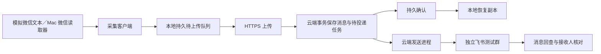

# v0.4.0 文本最小闭环实施计划

日期：2026-10-06。状态：M1、M2 已实现并完成独立环境验证；M3、M4 待实施。M1 操作见[端云接入操作](v0.4.0-端云接入操作.md)，证据与审查见[M1 验证记录](v0.4.0-M1验证记录.md)及[M2 验证记录](v0.4.0-M2验证记录.md)。

目标分两步验收：先让一条模拟微信文本经过实际客户端、实际云端并到达真实飞书测试群，再将输入替换为 Mac 微信读取器。单条文本通过不等于 v0.4.0 全部验收完成。

实施检查清单：

- [x] M1：客户端上传与云端持久确认。
- [x] M2：云端发送、模拟飞书出口与故障恢复。
- [ ] M3：已部署云服务器与真实飞书测试群。
- [ ] M4：Mac 微信真实采集与接收核对。

## 1. 完成后的最小路径

一条样本使用贯穿全程的事件身份和唯一测试标记，能关联本地待上传项、云端存档、发送部分与飞书消息回执。不能用日志中一句“成功”、健康检查或模拟出口回执代替真实送达证据。

## 2. 已有能力与本轮范围

| 部分 | 当前事实 | 本轮补齐 |
| --- | --- | --- |
| 输入和本地队列 | 文本队列、稳定事件 ID、重启续采、上传确认、恢复副本和状态迁移已实现 | 后续真实 Mac 验证与安装管理 |
| 云端 | HTTPS、隔离存档、待投递任务、独立发送器和持久回执已实现 | 部署与真实飞书接收核对 |
| 飞书发送 | 云端 HTTP 传输、逐部分回执、未知结果暂停已通过模拟出口验证 | 真实飞书回查与接收证据 |
| 验证 | `messages.py`、`control.py` 和真实 HTTPS/Postgres 的 `e2e.py` 已可运行 | 云端发送故障矩阵与真实飞书接收证据 |

首轮业务样例限制为一个试用用户、一台活跃 Mac、一个源群、一个独立飞书应用和测试群、普通文本。自动化另建第二个合成用户和第二个绑定，验证隔离和故障不互相阻塞；不能因为首轮只试一个真人用户而省略数据隔离。

完整后台操作流程、Mac 安装包/后台服务管理、Windows 真机、图片/文件等媒体、完整设备切换体验继续属于 v0.4.0，随后分别交付，不作为首条文本闭环的前置条件。最小闭环仍要校验活跃设备授权，不能提前开放未实现的设备切换。

依据以下已关闭决策实施，不重新决定业务规则：

- [确定 v0.4.0 首版镜像与存档的内容范围](https://github.com/litianc/w2f-cli/issues/38#issuecomment-5977953762)
- [确定云端原型的部署拓扑与开发隔离边界](https://github.com/litianc/w2f-cli/issues/39#issuecomment-5986685207)
- [确定双平台采集客户端的共同边界与交付范围](https://github.com/litianc/w2f-cli/issues/40#issuecomment-5990432333)
- [确定端云落库与飞书投递的恢复规则](https://github.com/litianc/w2f-cli/issues/41#issuecomment-6008946998)

## 3. 实施顺序与每段交付

### M1：模拟文本 → 客户端 → 云端持久接收确认

这是第一个开发切片，完成后就能证明客户端已经接入云端。

- 增加有版本的数据库迁移，以及用户、设备授权、源流、绑定、消息和投递任务的最小数据结构。提供受限管理命令创建独立测试用户/设备/绑定；每项可查询和停用，凭据仅写入受保护的私有配置。
- 新增客户端上传入口和设备级凭据；现有 Basic 密码继续只用于管理员，不能拿它给采集客户端当上传凭据。云端从认证信息确定用户归属，并核对源账号、群、设备和授权版本。
- 客户端从现有待上传队列出站上传，不重新生成事件 ID；每群按采集顺序推进。确认只覆盖实际持久保存的数据，不拿最大编号推定中间数据也已收到。
- 云端在同一事务中保存消息和唯一待投递任务，提交后才确认。相同事件/相同载荷返回已存结果，相同事件/不同载荷报冲突，不覆盖原记录。
- 客户端持久保存确认，再转为本地恢复副本，首次完整确认后保留 7 天。将待上传配额和已确认副本分开核算；未确认和待核对数据不自动删除。
- 提供只读消息状态查询及受限管理查询，至少能看到事件身份、所属绑定、接收状态、发送状态和失败原因。暂不等待完整后台页面。
- 新增 `verify-w2f` 端云验证入口，驱动模拟读取器、实际客户端进程、真实 HTTPS 接收接口和 Postgres。验证程序独立读取数据库和本地状态，不能手写目标消息表制造结果。

**通过条件**：一条带中文和 emoji 的模拟消息在客户端和云端各有一条对应记录；丢弃云端确认响应后补传仍只有一条存档和一份投递任务；客户端重启后正确识别原确认；不同用户、无权群和旧设备授权被拒绝。用可控时钟验证 7 天清理边界，不等待实际一周。

### M2：真实端云处理 → 模拟飞书出口，并验证故障恢复

依赖 M1；完成后得到可在本地和 CI 反复执行的自动化闭环。

- 增加独立的云端发送进程，与 API 使用同一版本镜像和数据库；API 请求中不直接同步等待飞书发送，不依赖仅存于内存的后台任务。
- 通过数据库互斥领取任务，保证同一绑定不并发发送或让新消息越过积压。进程重启保留请求、幂等身份、首次尝试时间和逐部分回执；失去处理权的进程不得继续提交后续发送。
- 从现有单机实现抽取可复用的纯文本渲染与回执语义；云端不直接启动旧 Worker，也不读取其默认 SQLite、配置或本机 CLI Profile。
- 建立同一飞书 HTTP 传输接口：自动化运行时连接夹具内的模拟飞书服务；真实模式连接飞书官方 API。覆盖实际序列化、请求、错误分类和回执解析，模拟服务不代替产品发送逻辑。
- 默认发送停用；测试绑定显式启用后才投递。提供精确绑定的暂停、状态查询和恢复入口。暂停不声称取消已经发出的在途请求，必须保留并核对结果。
- 覆盖短时断网、客户端/云端/发送进程重启、提交成功但确认丢失、同事件重复上报、飞书限流/确定失败/未知结果、两群故障隔离和已确认副本到期清理。

**通过条件**：一批有顺序标记的文本由实际云端发送器发出；重复提交和双方重启不新增同一发送部分。模拟“对方已接受但响应丢失”，确认系统沿用原身份，超出可证明安全的恢复范围后暂停该绑定并标记待核对；另一绑定仍能继续。验证未知结果时不能只数模拟出口去重后的消息，还要核对实际发送尝试。

### M3：模拟文本 → 已部署云服务器 → 真实飞书测试群

依赖 M1、M2 的自动化检查通过。这一步是第一个有真实飞书接收证据的云端闭环。

- 核对独立测试用户、设备、绑定、应用、目标群和已授权发送范围。飞书凭据保存在云端专属秘密文件中，客户端仅持上传凭据；未明确目标或缺少权限时报告阻塞，不借用 main 配置。
- 只读预检服务器 HTTPS 信任、发布版本、数据库迁移版本、发送进程状态，以及机器人入群、发送和消息回查权限。M3 的网络/凭据预检可提前做，真实发送等 M2 通过后再进行。
- 经既有 CI/CD 发布测试通过的镜像；每条真实样本明确记录客户端和云端版本，不能把旧服务器健康状态当新功能验收。
- 使用 Mac 上的新客户端和模拟读取器发送一条唯一文本；确认经过服务器 API、Postgres、云端发送器进入专属飞书测试群。
- 使用返回的飞书消息 ID 回查目标、发送应用和实际正文，再由接收人在飞书客户端确认可见。回查失败或缺少接收证据时不得把送达标成通过。
- 真实群只做有界、带唯一标记的冒烟样例；故障注入与大量重放留在 M2 的模拟出口。测试结束停止该次输入和测试绑定投递，保留必要证据，不自动删除群消息或常驻环境。

**通过条件**：同一测试标记的“源输入 → 本地事件 → 云端消息 → 发送部分 → 飞书回查 → 人眼可见”证据齐全；再次上传原事件不新增云端消息和飞书发送任务。只把这个结果称为“模拟微信输入的真实端云飞书闭环通过”。

### M4：Mac 微信真实采集 → 云端 → 飞书测试群

依赖 M3；只更换源端读取器，继续使用同一客户端上传与云端发送代码。

- 配置独立于 main 的客户端状态目录和已授权源群；通过实际 Mac 读取器建立启用时的起点，不导入启用前历史。
- 用户/测试参与者在源测试群发一条新的标记文本，由实际读取器发现；不用修改微信数据库或假装具备自动发送微信能力。
- 用受控、有界的采集与上传进程完成首轮；退出时清理本轮进程。验证长驻管理和安装体验另行实施，不能默认多开常驻采集进程。
- 核对 M3 同样的证据链，并增加实际源端新消息的记录；做一次有限断网后新文本补传，确认没有跳过启用后的消息。

**通过条件**：真实源端新消息、真实 Mac 采集、云端持久接收和真实飞书接收对应同一样本。记录时延，不在缺乏真实测量时承诺延迟指标；Windows 和媒体验收仍单独报告。

## 4. verify-w2f 的新增模式与边界

| 模式 | 输入 | 云端 | 飞书出口 | 用途 |
| --- | --- | --- | --- | --- |
| 已有本地消息模式 | 模拟读取器 | 无 | 本地模拟接收器或仅客户端队列 | 保持现有快速回归 |
| 已实现 M1 端云模式 | 模拟读取器 | 一次性真实 API/Postgres | 暂无发送，任务 pending | M1 端云边界回归 |
| 已实现 M2 投递模式 | 模拟读取器 | 一次性真实 API/Postgres/发送器 | 夹具内 HTTP 模拟出口 | M2 有序发送、故障矩阵与恢复 |
| 计划新增云端实发模式 | 模拟读取器 | 独立已部署原型服务器 | 专属真实飞书群 | M3，有界联调 |
| 计划新增 Mac 实采模式 | 实际 Mac 读取器 | 独立已部署原型服务器 | 专属真实飞书群 | M4，人工参与源端输入和接收核对 |

M1 实现位于 `.agents/skills/verify-w2f/scripts/e2e.py`，配方为 `features/text-cloud-e2e.md`；技能索引和 CI 已更新。M2 实现位于 `scripts/delivery.py`（同一技能目录），配方为 `features/cloud-delivery.md`。这两种自动化模式均不产生真实飞书群接收证据；M3、M4 后续扩展。

- 复用已有模拟读取器的数据契约和注入能力；新增端云驱动直接使用新客户端，不能经旧 Worker 绕过上传/云端发送。
- 保持 `messages.py` 的禁止网络规则。新模式独立限制网络：端云自动化仅允许本轮测试服务；真实模式明确固定服务器与飞书官方目的地。
- 每轮有唯一 run、用户/设备/绑定别名、端口、数据库/卷、证书和进程所有权记录。清理只能作用于本轮资源；禁止全局 Docker prune 或按进程名称批量终止。
- 自动化使用额外临时测试实例，不附着在现有本地 `13040` 实例；真实联调使用已部署的独立原型入口。默认不启动浏览器，只在验证页面时开启。
- 每轮即用即停；失败也执行所有权核验后的清理，并确认进程、容器和端口释放。常驻原型服务不被测试夹具清理。

## 5. 证据与自动化门槛

每轮至少保留一份汇总，包含模式、版本、样本标记、执行/阻塞原因及各阶段状态；再关联源注入记录、本地队列前后、云端实际存档、确认响应、投递部分、外部回执/回查、清理结果。真实群 ID、凭据和原始聊天不进入 Git 或 GitHub issue；真实映射只留在私有运行状态。

| 必须覆盖 | 最低断言 |
| --- | --- |
| 正常文本 | 中文、emoji 和发送者显示正确，目标绑定正确 |
| 重复和丢确认 | 稳定事件身份，一条云端存档、一份投递计划，未收到确认前本地不清理 |
| 重启 | 已提交数据保留，已确认部分不重发，未完成工作可恢复 |
| 顺序和隔离 | 同群旧先新后；一群待核对不阻塞另一群；跨用户读写和投递被拒绝 |
| 外部未知结果 | 固定请求/幂等身份，安全范围外暂停并提示，不伪造成功回执 |
| 保留与停止 | 已确认副本首次确认满 7 天才可清理；未确认/待核对保留；停止后核对在途请求 |
| 运行隔离 | main 和已有服务不受影响，本轮运行资源完全清理 |

M1 起将客户端测试、端云真实数据库集成测试纳入云端 CI；M2 再加入模拟飞书的完整链路及故障矩阵。更新触发路径，覆盖 `client/**`、验证入口、协议/渲染公共模块和相关测试，不能只在 `cloud/**` 改动时运行。CI 保存含清理结果的脱敏报告，而非仅保留旧 QA 目录。

普通推送继续“测试通过后自动发布”；CI 默认不向真实飞书群发送消息。真实冒烟使用有明确测试配置的独立执行模式，并单独记录结果，不用真实消息外发填补模拟测试覆盖不足。

## 6. 实现触点与发布约束

- `client/`：上传传输、确认持久化、恢复副本与状态；保留读取器解耦。新增字段需有本地状态库迁移，不删除已有队列重新初始化。
- `cloud/`：版本迁移、认证/接收、存档查询、投递队列、发送器与飞书传输边界；采用同一业务路径支持模拟/真实出口。
- M1 已将新增云端模块、迁移和 `w2f_protocol/` 纳入 Dockerfile 与构建上下文，并验证实际镜像；后续新增模块继续核对打包范围。
- `deploy/v040/compose.yaml` 增加发送服务角色；其资源限制、健康状态、停止与部署回滚需纳入 `cloud/runtime.py`、`deploy/v040/release.py` 及集成测试。当前验收助手写死三容器的判断也须更新为核对实际期望服务及镜像，不能只改数量。
- 现有 CI 发布通道只上传镜像，不能自动更新服务器上的 Compose 与发布脚本。M3 前安排一次受控的原型拓扑升级：备份并同步版本化部署配置/脚本、核对新服务及镜像角色，再验证失败回退；后续代码发布继续走原有受限通道。不能把新镜像发布成功当成发送服务已启用。
- 迁移先采用兼容旧版本的增量变更。发布前记录备份与迁移版本，验证镜像回退仍能读取迁移后的数据；回退镜像不等于恢复数据库。发送器部署/回退必须保证单一任务处理权，默认不启用未配置的绑定。
- 首个实现工作包就是 M1，先交付可独立运行和验收的真实端云保存/确认，不等待完整管理 UI。M2、M3、M4 串行推进；M3 的配置预检可提前准备。

## 7. 尚需就绪的联调条件

这些是执行前的环境核对，不是重新讨论已定需求：原型专用飞书应用和测试群及发送/回查权限；客户端可验证的服务器证书；明确的测试用户/设备/绑定配置；Mac 实采时已授权且可读取的源测试群，以及参与发送和接收核对的人。

缺其中某项时先完成不依赖它的本地实现和自动化验证，精确报告受阻阶段；不因此声称完整闭环已通过。

后台页面与全部版本验收继续由[确定集中管理后台的最小操作流程](https://github.com/litianc/w2f-cli/issues/42)、[确定 v0.4.0 原型的验收场景与交付门槛](https://github.com/litianc/w2f-cli/issues/43)收敛。本计划只交付其中的文本闭环，不关闭这两张决策票。

## 8. 飞书接口依据

2026-10-06 核对官方[发送消息文档](https://open.feishu.cn/document/server-docs/im-v1/message/create)（通过其公开文档接口读取）：应用机器人可向有权限的目标群发送文本，返回消息 ID；相同 `uuid` 的发送去重承诺是 1 小时，不是永久去重。因此本计划将本地/云端持久身份、已发送回执和未知结果暂停作为必要机制，不能仅靠重用 `uuid` 无限重试。

消息回查参考官方[获取指定消息的内容](https://open.feishu.cn/document/server-docs/im-v1/message/get)。本次其详细页面未能完整抓取；M3 预检必须核实实际应用权限与回查响应，不能仅凭文档链接认定现有应用具备回查能力。
