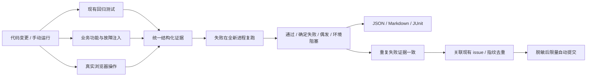

# 自动功能测试与 issue 提交

目标是持续发现可复现的功能缺陷，留下足够的验证证据，并把确定性的新问题提交到 GitHub。评价标准是发现率、误报率、复现成本和运行成本，不宣称无法验证的“全球第一”。

## 当前实现



- **回归层**：自动发现现有 unittest。断言失败进入复核；导入、驱动、网络权限等异常按环境或测试架构阻塞处理，需要人工诊断，不能直接作为产品 bug 发布。
- **业务层**：真实 Manager、SQLite 和 Worker，替换微信/飞书传输边界。覆盖人员生命周期、确认重放、更名历史、积压暂停恢复、投递回执丢失、媒体正常暂存与缺失降级。
- **浏览器层**：Playwright Chromium 驱动真实 HTML/JS 和 localhost HTTP API，使用临时数据库。覆盖六个页面、人员创建/更名/双身份关联、刷新持久化、空微信 ID 拒绝、HTML 字符的文本呈现。
- **确认层**：回归层只复跑失败用例；轻量业务探针和浏览器按组重放，报告只合并失败场景的两次证据。重放使用新进程和新临时数据库。至少两次失败且证据签名一致才标为 `confirmed_failure`。失败后通过或证据改变标为 `flaky`，环境问题标为 `blocked`。
- **平台范围**：只有明确登记的平台专属场景才标为 `not_applicable`，不计入通过数；其他意外跳过仍是 blocked。Rion watch 管道监听在 Windows 不适用，Windows 的 WDA/SSE 唤醒路径仍正常执行测试。Python 在 Windows 上的 selectors 不支持管道，见[官方平台说明](https://docs.python.org/3/library/selectors.html)。
- **发布层**：GitHub 全量分页查重。稳定场景 ID 写入隐藏指纹；显式关联 #14/#15 的检查复用现有 issue，不反复评论；已关闭的匹配进入回归复核，不自动重开。每轮最多创建 3 条；读失败不写，写结果不确定时停止，不盲重试。

这是由明确断言驱动的测试系统。AI 可协助设计新场景和分析 blocked/flaky 结果，但不作为唯一判定器，也不把模型猜测自动发布成缺陷。

## 本地运行

推荐 Python 3.12，安装：

```sh
python -m pip install -r requirements-qa.txt
python -m playwright install chromium
```

执行所有检查，生成结构化报告：

```sh
python -m qa.run
```

确定性失败自动提交：

```sh
python -m qa.run --publish
```

需要 `gh` 已登录且有项目 issue 写权限。此命令授权范围仅为提交测试发现的 issue，不会修改产品代码、关闭已有 issue 或发送真实微信/飞书消息。

其他入口：

```sh
# 仅业务和浏览器层
python -m qa.run --groups probes,browser
# 复现一个稳定场景
python -m qa.run --check identity.confirmation-replay
# 读取 GitHub 去重结果并生成发布预览，不写入
python -m qa.run --dry-run
# 发布可信的已生成报告，不重复跑测试
python -m qa.run --publish-report .qa-results/latest/report.json
```

报告默认输出至 `.qa-results/latest/`，已从 Git 排除：`report.json` 用于处理和发布，`report.md` 用于查看，`junit.xml` 用于 CI。报告保留合成数据的结构化证据，不保留真实聊天、环境变量、凭证、原始断言值或原始日志。

每个测试子进程使用独立数据、配置、媒体、WDA 缓存和临时目录，Python 启动守卫会拒绝真实外部 CLI、真实应用状态路径及非本机网络。浏览器仅允许访问夹具 HTTP 服务。进程跟踪与启动登记配合清理超时后遗留的后台 Worker，并核对 PID 创建时间。HOME 与 CODEX_HOME 保持不变。这是可信测试代码的意外 I/O 防护；它不替代用于运行恶意代码的容器或操作系统沙箱。

报告同时记录 commit 与实际源码指纹。验证期间代码改变则整轮标为 blocked，防止把不同代码版本的两次失败合并为“确定复现”。

退出码：`0` 全部适用检查通过；`1` 有确定性功能失败；`2` 有偶发或阻塞项；`3` 发布失败。报告中已关联旧 issue 的失败仍如实显示，不伪装为通过；明确不适用项单独统计。

## GitHub Actions

现有 tests 工作流扩展为 Linux、macOS、Windows 三平台。PR 和 main 更新均测试，另支持手动运行。每个平台上传独立证据，保留 14 天。

CI 使用 `python -m qa.gate .qa-results/ci/report.json` 判断是否允许合并。`qa/known_failures.json` 只登记已确认的 5 项遗留失败及其 issue：按场景 ID 和两次失败签名精确匹配，不改变报告中的失败结果。本地 `qa.run` 仍对任何功能失败返回非零。新失败、签名变化、偶发失败、环境阻塞、检查缺失都会阻断 CI；已知检查修复通过时，也要求在同一个 PR 删除对应条目，防止未来同类回归被旧条目放行。新增条目必须经过人工确认，测试和发布器不会自动扩充清单。

测试任务只有只读权限。自动发布只在本仓库可信 main 的 push 或手动运行中执行；独立发布 job 才持有 `issues: write`，并用固定 concurrency group 串行化。PR（包括 fork）不会自动写 issue。跨平台共享每轮 3 条的预算，后续平台命中同一场景只链接已有 issue。

工作流文件合并到 main 后生效。无需新建个人访问 token，CI 使用仓库提供的 `GITHUB_TOKEN`。不要从未知来源下载报告后执行发布；报告输入必须来自可信代码与同一轮测试。

GitHub 不提供 issue-create 幂等键，因此本地手动发布与 CI 发布仍应避免同时执行。创建结果不确定后先重新查重，再决定后续操作。

## 场景边界与后续扩展

| 场景 | 本轮自动验证 | 未宣称覆盖 |
| --- | --- | --- |
| 人员管理 | 真实 UI/API/数据库、重放与状态一致性 | 真实企业通讯录授权 |
| Worker | 幂等、暂停恢复、分页、丢失回执 | 真实断网与跨日负载 |
| 表情/语音 | 合成资源暂存、投递参数、回执、缺失占位 | macOS 微信资源发现、音频真实解码、飞书播放效果 |
| 系统运行 | 本机真实 HTTP 与浏览器、进程回归测试 | 微信客户端版本兼容性 |

因此 synthetic 媒体测试通过不等于 #14 被修复。真实链路测试需要另行提供专用测试账号/群和素材后才能补齐。

增加新场景时，以用户可观察行为命名稳定 ID，使用独立合成夹具，给出明确预期与固定证据；显式断言失败才报 failed，未知环境/脚本异常应 blocked。只有同一缺陷的已知 issue 才写 `related_issues`，泛相关 issue 不应用来吞掉新问题。

未来值得按实际成本逐步添加：真实链路合约验证、故障注入种类、状态机生成测试、经过人工复核的新增业务探针。先根据每次报告找到覆盖缺口，避免用不可靠的自动浏览或无限重试制造“全绿”。

## 设计依据

浏览器使用可访问角色、稳定定位与自动等待，减少固定 sleep 的偶发失败：[Playwright locators](https://playwright.dev/python/docs/locators)。

CI 默认只读权限，发布能力限制在可信分支与独立 job：[GitHub secure use](https://docs.github.com/en/actions/reference/security/secure-use)、[workflow permissions](https://docs.github.com/en/actions/reference/workflows-and-actions/workflow-syntax#permissions)。
